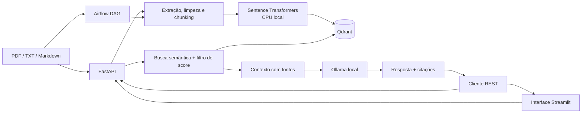

# RAG Pipeline — Engenharia de Dados e IA Generativa

Pipeline local de Retrieval-Augmented Generation (RAG): ingere PDF, TXT e Markdown, indexa chunks e embeddings no Qdrant e responde perguntas com contexto recuperado usando Ollama. A API é feita com FastAPI, a interface interativa usa Streamlit e o Airflow coordena a ingestão recorrente. Os serviços podem ser executados sem serviços pagos ou GPU.

## Arquitetura



### Fluxo de ingestão e consulta

1. Os loaders validam extensão e extraem texto (PyMuPDF preserva o número da página).
2. O cleaner normaliza Unicode e espaços; o chunker respeita tamanho e sobreposição configuráveis.
3. Sentence Transformers gera embeddings normalizados localmente.
4. IDs determinísticos por caminho de documento e índice de chunk permitem reprocessamento idempotente. Chunks antigos excedentes são removidos depois do upsert.
5. A busca filtra por `MIN_SCORE`; o prompt instrui o modelo a usar apenas o contexto e a citar as fontes recuperadas.

O identificador do documento deriva do caminho absoluto do arquivo. Mover ou renomear o arquivo cria um novo documento lógico; para refletir a movimentação, remova o documento antigo pela API.

## Tecnologias

Python 3.12, FastAPI, Streamlit, Pydantic, Sentence Transformers (`all-MiniLM-L6-v2`, 384 dimensões), PyMuPDF, Qdrant, Ollama (`qwen2.5:0.5b`), Apache Airflow 2.10.5, pytest, Ruff, pre-commit e Docker/Podman Compose. Dependências Python e imagens de infraestrutura estão fixadas no projeto.

## Pré-requisitos

- Docker com Docker Compose v2 **ou** Podman 5+ e Podman Compose.
- 8 GB de RAM recomendados; espaço livre para imagens, pesos do modelo de embeddings e modelo Ollama.
- Acesso à internet somente para obter imagens e baixar os modelos na primeira execução. As consultas e a inferência rodam localmente.
- Para execução fora de containers, Python 3.12.

O serviço Ollama usa CPU por padrão. O primeiro download do modelo pode levar alguns minutos e os modelos ocupam espaço em disco. Com 8 GB de RAM, mantenha `AIRFLOW_PARALLELISM=2` (ou reduza para `1`) e evite executar ingestões concorrentes.

## Configuração com Docker Compose

```bash
cp .env.example .env
# Edite .env, altere a senha local do Airflow e ajuste AIRFLOW_UID para `id -u`.
docker compose up --build -d
docker compose ps
docker compose exec ollama ollama pull qwen2.5:0.5b
```

O serviço baixa os pesos do embedding model do Hugging Face no primeiro uso. Ollama e o cache de embeddings persistem em volumes.

## Configuração com Podman Compose

O arquivo usa a especificação Compose comum e pode ser iniciado da mesma forma:

```bash
cp .env.example .env
# Edite .env, altere AIRFLOW_ADMIN_PASSWORD e ajuste AIRFLOW_UID para `id -u`.
podman-compose up --build -d
podman-compose ps
podman-compose exec ollama ollama pull qwen2.5:0.5b
```

`podman-compose config` valida a configuração resolvida. O comportamento de `depends_on` com condição de conclusão pode variar entre versões de Compose; se sua versão não suportar `service_completed_successfully`, atualize Podman Compose ou inicialize o banco Airflow manualmente com o comando `airflow db migrate` no container `airflow-init` antes de iniciar scheduler e webserver.

### GPU (opcional)

A configuração padrão não exige GPU. Ollama pode usar GPU automaticamente quando o runtime e os drivers do host estão configurados. Para NVIDIA com Docker, habilite o NVIDIA Container Toolkit e adicione ao serviço `ollama` uma reserva de dispositivo GPU suportada pela versão instalada do Compose. No Podman, configure CDI (`nvidia.com/gpu=all`) de acordo com a versão e o runtime do host. Essa personalização não é necessária para execução CPU.

## Ingestão de documentos

Arquivos colocados em `data/raw/` ficam disponíveis à API e ao Airflow:

```bash
cp ~/documentos/manual.pdf data/raw/
podman-compose exec api python scripts/ingest_documents.py
```

Também é possível enviar um arquivo individual:

```bash
curl -X POST http://localhost:8000/documents/ingest \
  -F "file=@./manual.pdf"
```

Ou pedir a ingestão de um diretório sob `data/raw`:

```bash
curl -X POST http://localhost:8000/documents/ingest \
  -F "directory=."
```

A API limita uploads a 50 MiB. A ingestão recursiva ignora extensões não suportadas. Um documento inválido é registrado em log e ignorado durante uma ingestão de diretório; falhas de infraestrutura interrompem a requisição. A DAG `rag_document_ingestion` executa descoberta, extração/limpeza/chunking, embeddings e indexação em tarefas separadas. Arquivos intermediários persistidos em `data/processed/airflow/` evitam transferir conteúdo ou vetores grandes pelo XCom. Para simplificar a execução local, o Compose usa SQLite com `SequentialExecutor`; para um deployment distribuído, use um banco suportado para metadados e um executor apropriado.

## API

- `GET /health` — estado da API, Qdrant e Ollama (`503` se dependência não estiver pronta).
- `POST /documents/ingest` — multipart com `file` **ou** `directory`.
- `GET /documents` — documentos indexados e contagem de chunks.
- `DELETE /documents/{document_id}` — exclui documento e chunks.
- `POST /chat` — pergunta com resposta, fontes, scores e tempo de processamento.

## Interface Streamlit

Com os serviços iniciados pelo Compose, abra <http://localhost:8501>. A interface chama a API FastAPI existente e oferece:

- **Ingestão:** envie PDF, TXT ou Markdown (até 50 MiB) e veja a contagem de chunks e o ID do documento.
- **Chat:** faça perguntas e consulte a resposta, o tempo de processamento e as fontes com página, score e trecho.
- **Documentos:** veja os documentos indexados e remova um documento e seus chunks.

A porta pode ser alterada com `STREAMLIT_PORT`. O serviço Streamlit usa `API_BASE_URL=http://api:8000` na rede interna do Compose; a API continua disponível em `http://localhost:8000/docs`.

Exemplos:

```bash
curl http://localhost:8000/health
curl http://localhost:8000/documents
curl -X POST http://localhost:8000/chat \
  -H 'Content-Type: application/json' \
  -d '{"question":"Quais são os principais tópicos do manual?"}'
curl -X DELETE http://localhost:8000/documents/<document_id>
```

OpenAPI/Swagger: <http://localhost:8000/docs>. O Airflow fica em <http://localhost:8080>; configure usuário e senha locais em `.env` (`AIRFLOW_ADMIN_USERNAME` e `AIRFLOW_ADMIN_PASSWORD`) antes de iniciar. O arquivo `.env` não deve ser versionado.

## Execução local de desenvolvimento

```bash
python3.12 -m venv .venv
source .venv/bin/activate
python -m pip install --extra-index-url https://download.pytorch.org/whl/cpu -e ".[dev]"
cp .env.example .env
```

Inicie Qdrant e Ollama separadamente ou use Compose para esses serviços. Para iniciar a API localmente com serviços em containers, ajuste no `.env` `QDRANT_URL=http://localhost:6333` e `OLLAMA_BASE_URL=http://localhost:11434`, e execute `uvicorn app.main:app --reload`, `python scripts/ingest_documents.py` e `python scripts/download_models.py` conforme necessário.

## Testes e qualidade

```bash
pytest
ruff check .
ruff format --check .
pre-commit install
```

Os testes unitários não iniciam Qdrant nem Ollama. O teste de integração Qdrant é ignorado por padrão; defina `QDRANT_TEST_URL=http://localhost:6333` para executá-lo. Os testes da API usam mocks. Atalhos estão no `Makefile`.

## Configuração

Consulte `.env.example`. Principais parâmetros:

| Variável | Padrão | Descrição |
|---|---|---|
| `QDRANT_URL` / `QDRANT_COLLECTION` | localhost / `rag_documents` | Endereço e collection Qdrant |
| `OLLAMA_BASE_URL` / `OLLAMA_MODEL` | localhost / `qwen2.5:0.5b` | Endpoint e modelo de geração |
| `EMBEDDING_MODEL` | `sentence-transformers/all-MiniLM-L6-v2` | Modelo local de embeddings |
| `CHUNK_SIZE` / `CHUNK_OVERLAP` | `800` / `120` | Tamanho em caracteres e sobreposição |
| `TOP_K` / `MIN_SCORE` | `5` / `0.25` | Limite de recuperação e score mínimo |
| `DATA_DIR` | `data/raw` | Entrada de arquivos |
| `AIRFLOW_PARALLELISM` | `2` | Concorrência global limitada para máquinas modestas |

O PyTorch CPU está fixado para evitar baixar dependências CUDA em máquinas sem GPU. O tamanho dos chunks é medido em caracteres, não tokens. Uma collection existente com dimensão diferente do modelo configurado resulta em erro explícito; use outra collection ou recrie a collection conscientemente.

## Observabilidade e segurança

Logs incluem timestamp, nível e logger; Airflow registra cada etapa e possui retries. A API valida formatos, caminhos de diretório e tamanho de upload. O prompt trata texto recuperado como conteúdo não confiável; essa proteção não substitui controles de acesso. Compose expõe portas para desenvolvimento local e não configura autenticação na API ou no Qdrant: não publique esses serviços diretamente na internet. Use secrets e autenticação apropriados antes de qualquer implantação compartilhada.

## Problemas comuns

- **Health retorna 503:** confira `podman-compose ps`/`docker compose ps`, Qdrant na porta 6333 e Ollama na 11434.
- **Primeira pergunta lenta:** os pesos de embeddings e o modelo Ollama precisam ser baixados inicialmente; aguarde o download.
- **Collection com dimensão incompatível:** altere `QDRANT_COLLECTION` ou faça backup e recrie a collection para o modelo atual.
- **Airflow não inicia:** confira permissões do diretório de dados, usuário `AIRFLOW_UID` e suporte da versão Compose para dependências por condição.
- **Pouca memória:** reduza `AIRFLOW_PARALLELISM=1`, use o modelo Ollama `qwen2.5:0.5b` e ingira em lotes menores.
- **PDF sem conteúdo:** PDFs escaneados precisam de OCR, que não está incluído.

## Limitações conhecidas e roadmap

- Não há OCR, autenticação/autorização, isolamento por usuário nem limite de taxa; o exemplo é para uso local e confiável.
- A lista de documentos percorre até 10.000 pontos por chamada. Para grandes volumes, implemente paginação e catálogo separado.
- O reranker atual é uma interface com implementação identidade; a busca usa similaridade cosseno sem reranking.
- Melhorias previstas: OCR opcional, reranking local, avaliação de qualidade/groundedness, métricas Prometheus, retenção e controle de acesso, testes de carga e estratégias de chunking semântico.
